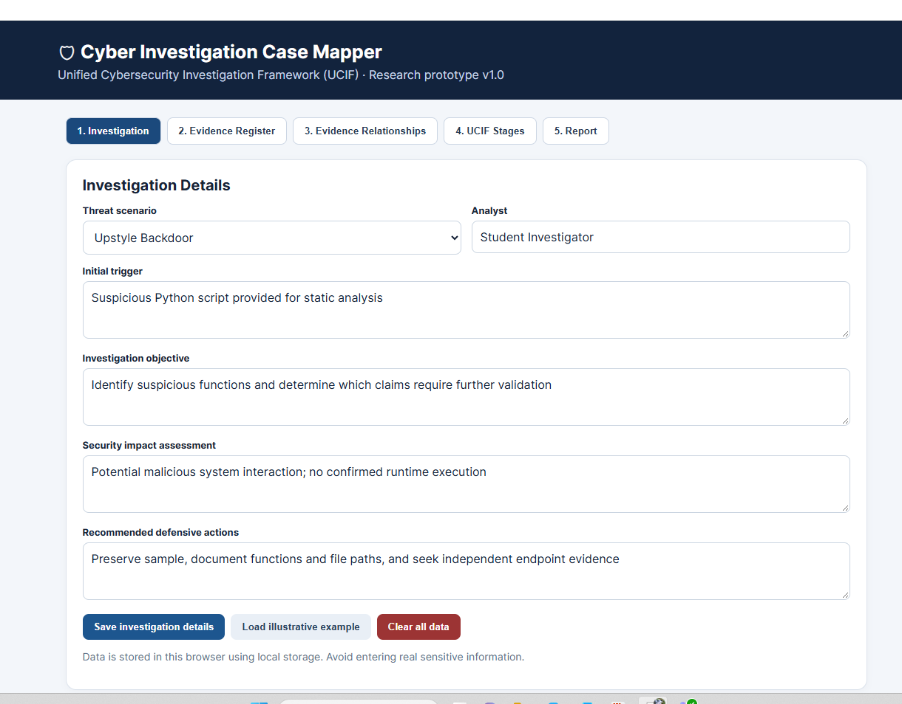
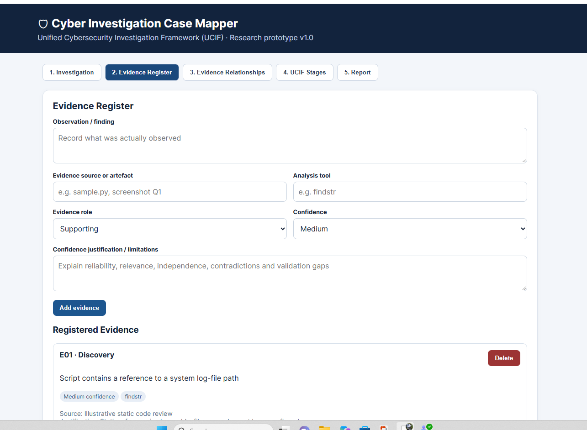
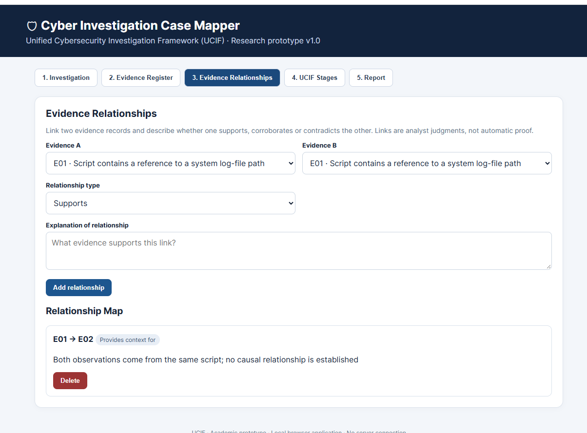
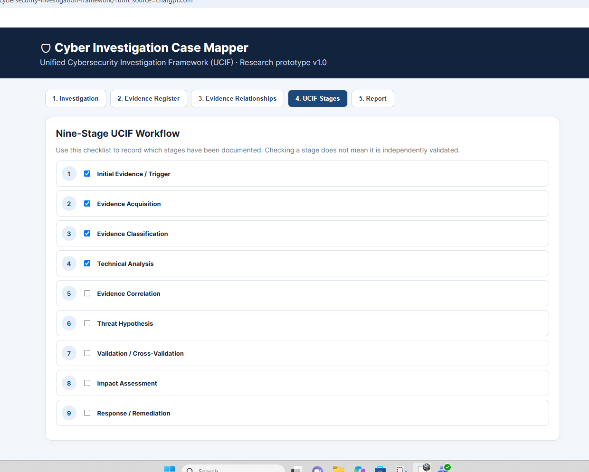
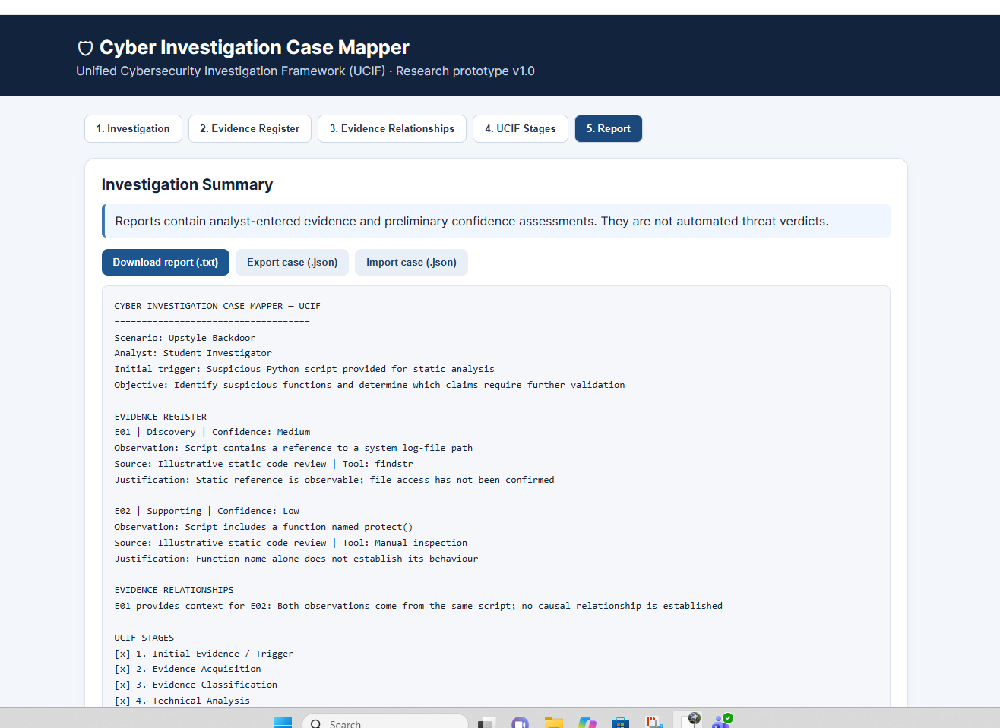

# Cyber Investigation Case Mapper (CICM)

**Unified Cybersecurity Investigation Framework (UCIF) | Research Prototype v1.0**

A browser-based cybersecurity investigation prototype developed as part of the University of Technology Sydney (UTS) 43001 Cybersecurity Challenge Studio, Spring 2026.

[Live Application Demo](https://mohamed4699.github.io/cybersecurity-investigation-framework/)

## Project Overview

CICM supports structured cybersecurity investigations by helping analysts document investigation scenarios, register and assess evidence, map relationships between findings, track investigation stages, and export case summaries.

The application is designed as a teaching and research prototype, not a production incident response platform.

## Key Features

- Investigation details and threat scenario documentation
- Evidence register with source, analysis tool, role, and confidence assessment
- Evidence relationship mapping with analyst explanations
- Nine-stage UCIF investigation checklist
- Investigation summary and downloadable TXT reports
- JSON case export and import controls
- Browser-based local storage
- Illustrative investigation data for demonstrations

## Live Demo

**[Launch CICM](https://mohamed4699.github.io/cybersecurity-investigation-framework/)**

Select **Load illustrative example** to explore the prototype using fictional demonstration data.

## Application Screenshots

### 1. Investigation Details

### 2. Evidence Register

### 3. Evidence Relationships

### 4. Nine-Stage UCIF Workflow

### 5. Investigation Summary

## Nine-Stage UCIF Methodology

1. Initial Evidence / Trigger
2. Evidence Acquisition
3. Evidence Classification
4. Technical Analysis
5. Evidence Correlation
6. Threat Hypothesis
7. Validation / Cross-Validation
8. Impact Assessment
9. Response / Remediation

The checklist records documented stages; it does not independently validate investigation findings.

## Technology Stack

- HTML5
- CSS3
- JavaScript
- Browser Local Storage
- GitHub Pages

## Running Locally

1. Download or clone this repository.
2. Open `index.html` in a modern web browser.
3. Select **Load illustrative example** to explore the application.

No installation or backend server is required.

## Testing

The five application sections have been visually reviewed using the illustrative Upstyle Backdoor investigation. TXT report download and JSON case export were also tested successfully.

Additional functional and security testing is recommended before wider use.

## Security and Limitations

CICM is an academic research and teaching prototype. It does not perform automated malware detection, independently validate evidence, or provide a secure multi-user evidence repository.

Investigation data is stored in the user's browser. Do not enter real sensitive, confidential, or production incident data.

## Academic Context

Developed for **43001 Cybersecurity Challenge Studio — Spring 2026**, University of Technology Sydney (UTS).

This public repository is a portfolio adaptation of the application component and does not represent the complete academic assessment submission.

## Project Focus

Cybersecurity Investigation | Digital Forensics | Incident Response | Evidence Analysis | Threat Investigation
  
